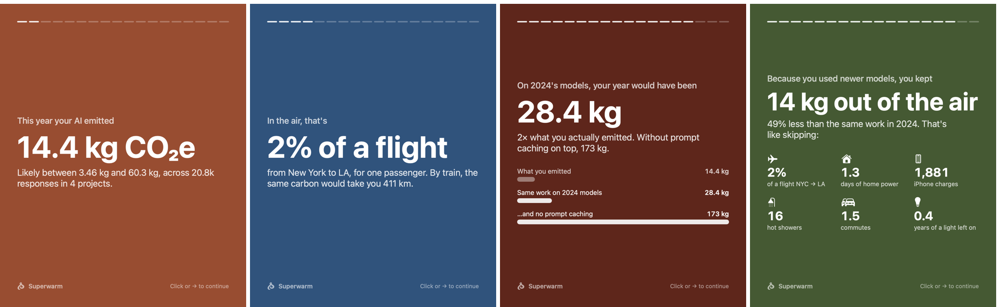

<div align="center">


# Superwarm

**The carbon footprint of your AI coding agents, in your menu bar.**

Superwarm reads the token counts Claude Code and Codex already log on your Mac,<br>
turns them into evidence-backed energy and CO₂e estimates, and shows<br>
how much newer, more efficient models are saving.

[](https://github.com/camggould/superwarm/actions/workflows/ci.yml)
[](https://github.com/camggould/superwarm/releases/latest)

[](LICENSE)

<br>

<picture>
  <source media="(prefers-color-scheme: dark)" srcset="docs/images/popover-dark.png">
  
</picture>

<sub>Screenshots use a synthetic demo year, not real logs.</sub>

</div>

## Install

```sh
curl -fsSL https://raw.githubusercontent.com/camggould/superwarm/main/scripts/install.sh | bash
```

This downloads the latest release, verifies its SHA-256 checksum, installs it
to `~/Applications` and launches it. Requires **macOS 14 Sonoma or later**, on
Apple Silicon or Intel.

<details>
<summary><b>Or download it manually</b></summary>

1. Download `Superwarm-<version>.zip` from the
   [latest release](https://github.com/camggould/superwarm/releases/latest) and unzip it.
2. Move **Superwarm.app** to `/Applications` or `~/Applications` and open it.
3. Superwarm isn't signed with a paid Apple Developer ID yet, so macOS will say it
   "cannot verify" the app the first time. Open **System Settings → Privacy &
   Security**, scroll to Security and click **Open Anyway**. You only need to
   do this once.

</details>

<details>
<summary><b>Or build from source</b></summary>

```sh
git clone https://github.com/camggould/superwarm.git
cd superwarm
scripts/install-app.sh
```

Needs Xcode 16 or later. See [CONTRIBUTING.md](CONTRIBUTING.md).

</details>

### Updates

Superwarm checks for updates daily and shows **Update to x.y** in the popover
when one is ready. Updates are signed with an EdDSA key held only by the
maintainer and verified before installing (via [Sparkle](https://sparkle-project.org)).
Change this under **Settings → Updates**.

### Uninstall

Quit Superwarm from its popover, then:

```sh
rm -rf ~/Applications/Superwarm.app /Applications/Superwarm.app \
  ~/Library/Application\ Support/Superwarm
defaults delete com.camggould.superwarm
```

## What it shows

- **Today's CO₂e in the menu bar**, and a popover for today, 7 days, 30 days,
  the year or all time.
- **A likely range on every number.** Inference energy isn't published, so
  Superwarm shows an estimate with an approximate 90% interval rather than
  false precision.
- **Everyday comparisons** in three domains: your commute, a beef burger, and
  your home's electricity.
- **How you compare:** against the same work on 2024-era models, against the
  previous period, and what smaller models could save.
- **A chart** by hour, day, week or month, split by Claude Code and Codex,
  plus a per-model breakdown.

### Year in Carbon

Every December, Superwarm offers a year-in-review slideshow of your AI coding:
the total, how bad it could have been on 2024's models, what newer models kept
out of the air, and a pile of everyday equivalents (flights, iPhone charges,
showers, light bulbs left on). It ends with a card you can save or share.

<p align="center">
  
</p>

<p align="center">
  
</p>

Preview it any time from **Settings → Year in Carbon**.

## How the estimate works

```
CO₂e = tokens × energy per token (by model size and generation) × PUE × grid intensity
```

- **Energy per token** is anchored on published estimates for GPT-4o-class
  models ([Epoch AI](https://epoch.ai/gradient-updates/how-much-energy-does-chatgpt-use),
  [Jegham et al.](https://arxiv.org/abs/2505.09598)), scaled by model size.
- **Input and cached tokens** cost a fraction of output tokens. That matters,
  because agents re-read billions of cached tokens.
- **Newer models are cheaper per token.** Google measured a
  [33× drop](https://arxiv.org/abs/2508.15734) in a year, and B200s are ~1.7×
  more efficient than H100s. Superwarm conservatively assumes 1.67× per year.
- **Electricity** uses the US grid average by default (EPA eGRID). Change it in
  Settings.

Every coefficient, range and source is in [docs/METHODOLOGY.md](docs/METHODOLOGY.md)
and in the app under **ⓘ → How Superwarm estimates**. Training, hardware
manufacturing and water aren't included yet.

## Privacy

Everything stays on your Mac. Superwarm only reads your agents' local logs and
writes a cache to `~/Library/Application Support/Superwarm`. Its only network
request is the daily update check against GitHub. The shareable card leaves
out project names.

## Command line

`superwarm-cli` prints the same report in a terminal:

```sh
swift run -c release superwarm-cli month   # today | week | month | year | all
```

## Supported tools

| Tool | Logs read |
|---|---|
| [Claude Code](https://www.anthropic.com/claude-code) | `~/.claude/projects` (or `$CLAUDE_CONFIG_DIR`) |
| [Codex](https://github.com/openai/codex) | `~/.codex/sessions` and `archived_sessions` (or `$CODEX_HOME`). Compressed `.jsonl.zst` logs need `zstd` (`brew install zstd`). |

Want another tool supported? [Open an issue](https://github.com/camggould/superwarm/issues)
with an example of its log format.

## Contributing

Contributions are welcome, especially better sources for the model. Start
with [CONTRIBUTING.md](CONTRIBUTING.md). Coding agents should read
[AGENTS.md](AGENTS.md).

## License

[MIT](LICENSE)
