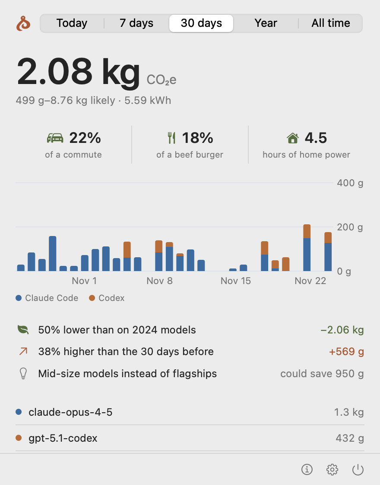
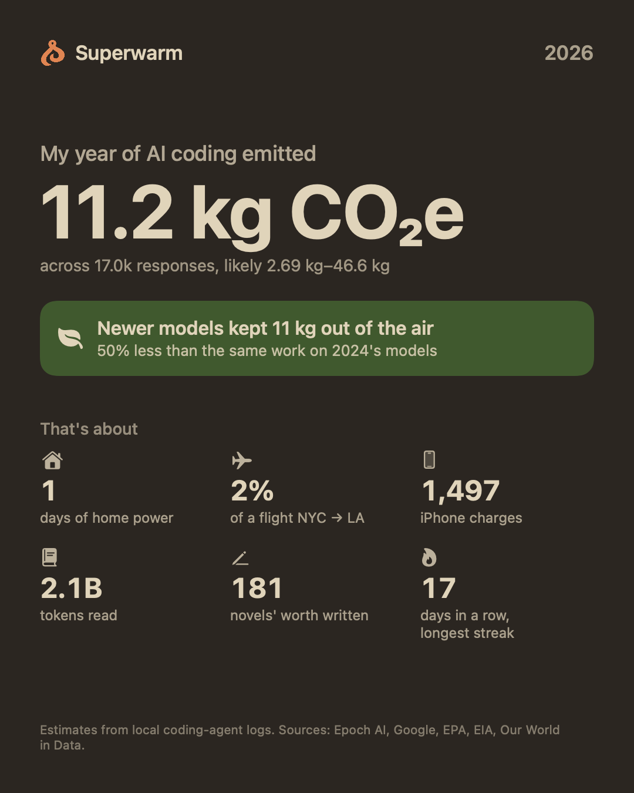
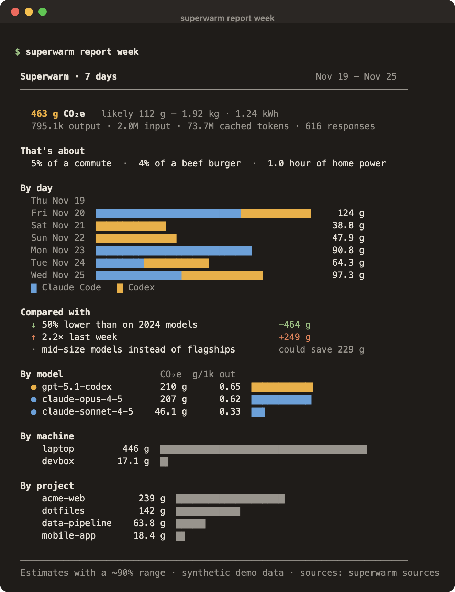
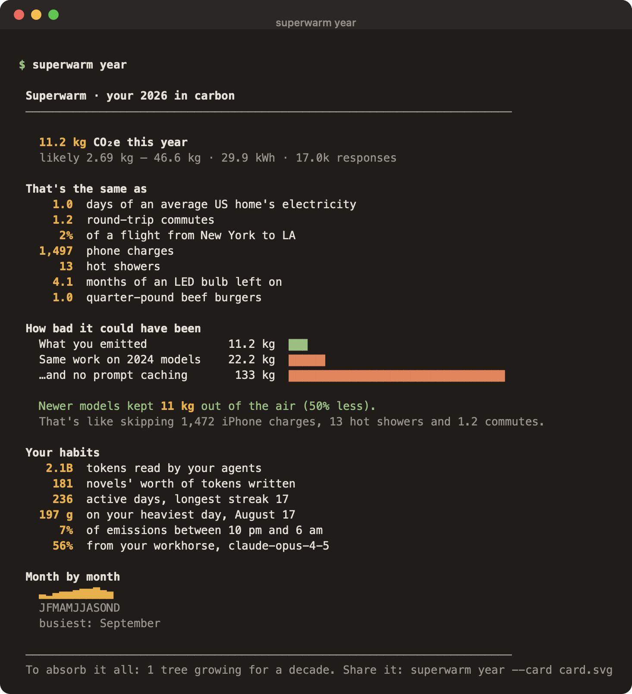
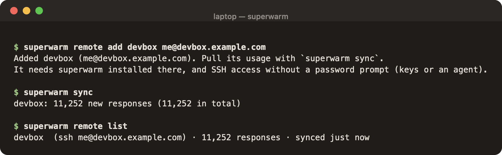

<div align="center">


# Superwarm

**The carbon footprint of your AI coding agents, in your menu bar or terminal.**

Superwarm reads the token counts Claude Code, Codex and Antigravity already log on your machine,<br>
turns them into evidence-backed energy and CO₂e estimates, and shows<br>
how much newer, more efficient models are saving.

[](https://github.com/camggould/superwarm/actions/workflows/ci.yml)
[](https://github.com/camggould/superwarm/releases/latest)


[](LICENSE)

<br>

<picture>
  <source media="(prefers-color-scheme: dark)" srcset="docs/images/popover-dark.png">
  
</picture>

<sub>Screenshots use a synthetic demo year, not real logs.</sub>

</div>

## Install

```sh
curl -fsSL https://raw.githubusercontent.com/camggould/superwarm/main/scripts/install.sh | bash
```

This downloads the latest release and verifies its SHA-256 checksum, then:

- **macOS 14 Sonoma or later** (Apple Silicon or Intel): installs the menu bar
  app to `~/Applications` and launches it.
- **Linux** (x86_64 or ARM64, any distribution): installs the `superwarm` CLI
  to `~/.local/bin`. See [Linux and the command line](#linux-and-the-command-line).

<details>
<summary><b>Or download it manually</b></summary>

1. Download `Superwarm-<version>.zip` from the
   [latest release](https://github.com/camggould/superwarm/releases/latest) and unzip it.
2. Move **Superwarm.app** to `/Applications` or `~/Applications` and open it.
3. Superwarm isn't signed with a paid Apple Developer ID yet, so macOS will say it
   "cannot verify" the app the first time. Open **System Settings → Privacy &
   Security**, scroll to Security and click **Open Anyway**. You only need to
   do this once.

</details>

<details>
<summary><b>Or build from source</b></summary>

```sh
git clone https://github.com/camggould/superwarm.git
cd superwarm
cargo install --path engine   # the CLI, on any platform
scripts/install-app.sh        # the macOS app (needs Xcode 16 or later)
```

Needs a recent stable Rust. See [CONTRIBUTING.md](CONTRIBUTING.md).

</details>

### Updates

Superwarm checks for updates daily and shows **Update to x.y** in the popover
when one is ready. Updates are signed with an EdDSA key held only by the
maintainer and verified before installing (via [Sparkle](https://sparkle-project.org)).
Change this under **Settings → Updates**.

### Uninstall

On macOS, quit Superwarm from its popover, then:

```sh
rm -rf ~/Applications/Superwarm.app /Applications/Superwarm.app \
  ~/Library/Application\ Support/Superwarm ~/Library/Caches/superwarm
defaults delete com.camggould.superwarm

# Linux
rm -rf ~/.local/bin/superwarm ~/.cache/superwarm
```

## What it shows

- **Today's CO₂e in the menu bar**, and a popover for today, 7 days, 30 days,
  the year or all time.
- **A likely range on every number.** Inference energy isn't published, so
  Superwarm shows an estimate with an approximate 90% interval rather than
  false precision.
- **Everyday comparisons** in three domains: your commute, a beef burger, and
  your home's electricity.
- **How you compare:** against the same work on 2024-era models, against the
  previous period, and what smaller models could save.
- **A chart** by hour, day, week or month, split by tool (Claude Code, Codex, Antigravity),
  plus a per-model breakdown.

### Year in Carbon

Every December, Superwarm offers a year-in-review slideshow of your AI coding:
the total, how bad it could have been on 2024's models, what newer models kept
out of the air, and a pile of everyday equivalents (flights, iPhone charges,
showers, light bulbs left on). It ends with a card you can save or share.

<p align="center">
  
</p>

<p align="center">
  
</p>

Preview it any time from **Settings → Year in Carbon**.

## How the estimate works

```
CO₂e = tokens × energy per token (by model size and generation) × PUE × grid intensity
```

- **Energy per token** is anchored on published estimates for GPT-4o-class
  models ([Epoch AI](https://epoch.ai/gradient-updates/how-much-energy-does-chatgpt-use),
  [Jegham et al.](https://arxiv.org/abs/2505.09598)), scaled by model size.
- **Input and cached tokens** cost a fraction of output tokens. That matters,
  because agents re-read billions of cached tokens.
- **Newer models are cheaper per token.** Google measured a
  [33× drop](https://arxiv.org/abs/2508.15734) in a year, and B200s are ~1.7×
  more efficient than H100s. Superwarm conservatively assumes 1.67× per year.
- **Electricity** uses the US grid average by default (EPA eGRID). Change it in
  Settings.

Every coefficient, range and source is in [docs/METHODOLOGY.md](docs/METHODOLOGY.md),
in the app under **ⓘ → How Superwarm estimates**, and in `superwarm sources`. Training, hardware
manufacturing and water aren't included yet.

## Privacy

Everything stays on your machine. Superwarm only reads your agents' local logs
and writes a parse cache (`~/Library/Caches/superwarm` on macOS,
`~/.cache/superwarm` on Linux). The CLI makes no network requests except
`sync`, which connects only to machines you added, over your own SSH. The macOS
app also checks GitHub daily for updates. The shareable card leaves
out project names.

## Linux and the command line

The engine behind the app is a standalone CLI. It runs anywhere your agents do:
a Linux workstation, a remote dev box, a cloud VM.

<p align="center">
  
</p>

| Command | What it shows |
|---|---|
| `superwarm report [today\|week\|month\|year\|all]` | Emissions with their likely range, everyday comparisons, a chart, comparisons, and breakdowns by model, machine and project. `--json` for scripts. |
| `superwarm year [YEAR]` | Your year in carbon (below). `--card card.svg` also writes the shareable summary card. |
| `superwarm export` / `import` | Move usage between machines by hand (see [Remote machines](#remote-machines)). |
| `superwarm remote add\|list\|remove`, `superwarm sync` | Pull usage from your other machines over SSH. |
| `superwarm sources` | Every published source behind the numbers. |
| `superwarm snapshot` | Everything, as one JSON document (what the macOS app reads). |

Options for any command: `--grid <g/kWh>` (default 373, the US average),
`--pue`, `--commute <miles>`, `--local-only`, `--color auto|always|never`
(colour is off when piped or when `NO_COLOR` is set), `--demo` for synthetic
data, `--no-cache`.

On macOS the app bundles the same CLI:
`ln -sf ~/Applications/Superwarm.app/Contents/Helpers/superwarm ~/.local/bin/superwarm`.

### Your year in the terminal

`superwarm year` is the Year in Carbon recap for terminals: equivalents, how
bad it could have been on 2024's models, and your habits.

<p align="center">
  
</p>

`superwarm year --card card.svg` writes the same shareable card as the Mac app,
with no screen needed. Open it in a browser, or `rsvg-convert -o card.png card.svg`.
Project names are never on the card.

<sub>Screenshots use synthetic demo data (`--demo`).</sub>

## Remote machines

Running agents on a remote dev box or cloud VM? Install the CLI there with the
same one-liner, then pull its usage to your laptop:

<p align="center">
  
</p>

- **Over SSH, nothing to run on the remote.** `sync` runs
  `ssh devbox superwarm export --since …` with your existing keys (or agent).
  It never prompts, opens no ports and needs no daemon. An unreachable host
  fails within seconds.
- **Incremental.** Each sync fetches only what's new since the last one, so
  syncing every few minutes is cheap.
- **Usage only.** Remotes send timestamps, model names, token counts and
  project folder names, never prompts, code or full paths. Add `--no-projects`
  on the remote to send no folder names at all.
- **Everywhere.** Reports, `year`, the share card and the Mac app include
  remote usage, with a **By machine** breakdown. `--local-only` leaves it out.
- **In the Mac app:** add machines under **Settings → Remote machines**. The
  app syncs them every 15 minutes, or when you click **Sync Now**.

No SSH access from your laptop? Copy an export instead:

```sh
devbox$  superwarm export > devbox.jsonl          # or: --since 2026-11-01
laptop$  superwarm import devbox.jsonl --machine devbox
```

If `superwarm` isn't in the remote's `~/.local/bin` or on its PATH, point to it:
`superwarm remote add devbox me@devbox --binary /opt/superwarm/bin/superwarm`.

## Supported tools

| Tool | Logs read |
|---|---|
| [Claude Code](https://www.anthropic.com/claude-code) | `~/.claude/projects` (or `$CLAUDE_CONFIG_DIR`) |
| [Codex](https://github.com/openai/codex) | `~/.codex/sessions` and `archived_sessions` (or `$CODEX_HOME`). |
| [Antigravity](https://antigravity.google) (`agy`) | `~/.gemini/antigravity-cli/conversations`. Read from a private copy, so a running `agy` is never disturbed. |

Want another tool supported? [Open an issue](https://github.com/camggould/superwarm/issues)
with an example of its log format.

## Contributing

Contributions are welcome, especially better sources for the model. Start
with [CONTRIBUTING.md](CONTRIBUTING.md). Coding agents should read
[AGENTS.md](AGENTS.md).

## License

[MIT](LICENSE)
